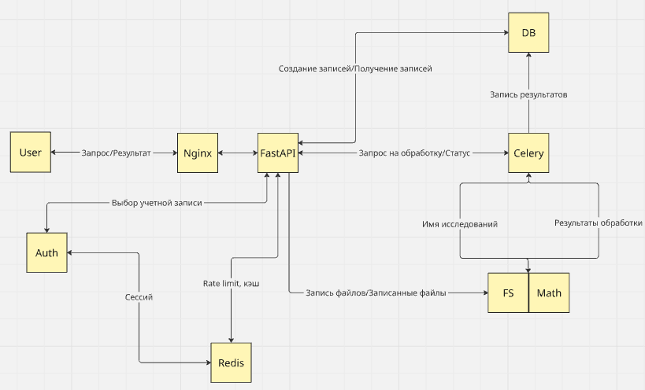
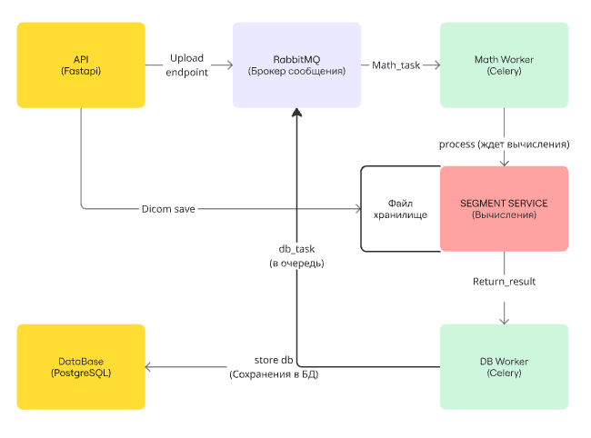
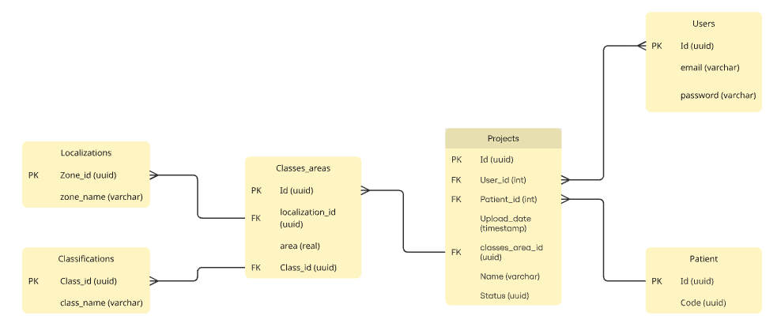
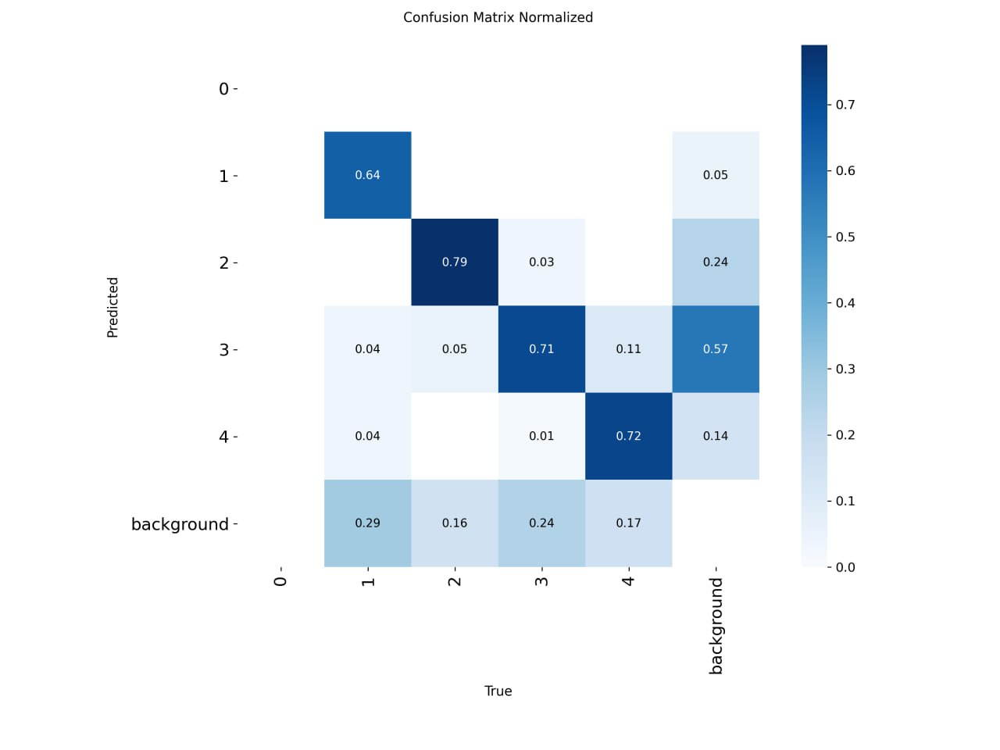
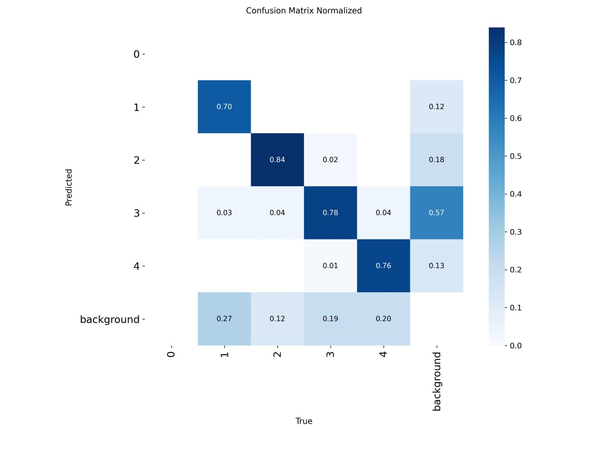

# Medical Image Segmentation Service

## Overview

AI-powered medical imaging platform for automated brain MRI analysis and volumetric assessment.
Designed as a production-ready microservice system for clinical and research use.

## Problem

- Manual analysis of brain MRI is time-consuming and subjective
- Neurologists need fast, accurate volumetric measurements of brain structures
- No unified tool that combines DICOM processing, segmentation, and result visualization

## Solution

End-to-end AI-driven medical imaging pipeline with asynchronous processing and scalable microservice architecture:

**DICOM Upload → Preprocessing → YOLO Detection → FastSurfer Segmentation → Volume Calculation → Interactive Visualization**

## Key Features

- Fully asynchronous processing (RabbitMQ + Celery)
- Scalable microservice architecture (11 containers)
- Automated DICOM → segmentation → volumetric analysis pipeline
- GPU-accelerated brain segmentation (FastSurfer)
- Interactive web UI for visualization and patient management

## Architecture



```
User ──► Nginx (reverse proxy)
              ├──► React Frontend (Vite + MUI)
              └──► FastAPI Backend
                      ├──► PostgreSQL (patient metadata)
                      └──► RabbitMQ ──► Celery Workers
                                            ├──► Math App (DICOM conversion, YOLO)
                                            └──► FastSurfer (GPU segmentation)
```

### Processing Pipeline



### Database Schema



## Tech Stack

| Layer | Technologies |
|-------|-------------|
| **Frontend** | React, TypeScript, Vite, Material UI |
| **Backend** | Python, FastAPI, SQLAlchemy, Alembic |
| **ML Models** | YOLO (detection), FastSurfer (segmentation) |
| **Async Processing** | Celery, RabbitMQ, Flower (monitoring) |
| **Database** | PostgreSQL, asyncpg |
| **Infrastructure** | Docker Compose, Nginx, pgAdmin |
| **GPU** | NVIDIA CUDA (FastSurfer container) |

## Results

### Model Performance (YOLO fine-tuning)

Fine-tuned YOLO segmentation model on brain MRI slices (5 classes, 100 epochs, imgsz=640).
Evaluated on clinical MRI dataset. End-to-end processing time reduced to seconds per study.

| Class | Precision (v1) | Precision (v2) |
|-------|:--------------:|:--------------:|
| 1 — I | 0.64 | **0.70** |
| 2 — P | 0.79 | **0.84** |
| 3 — S | 0.71 | **0.78** |
| 4 — U | 0.72 | **0.76** |

#### Confusion Matrix (before / after tuning)

<p align="center">
  
  
</p>

## Impact

- Enables automated and reproducible analysis of brain MRI
- Reduces time required for lesion analysis from tens of minutes to seconds
- Supports clinical decision-making with quantitative volumetric data
- Designed for integration into clinical workflows (PACS/RIS systems)

## My Contribution

- Designed microservice architecture (11 containers orchestrated via Docker Compose)
- Implemented FastAPI backend with async database operations
- Built asynchronous ML pipeline: RabbitMQ → Celery workers → YOLO + FastSurfer
- Fine-tuned YOLO model for brain MRI segmentation, improving precision across all classes
- Developed React frontend for patient management and result visualization
- Configured Nginx reverse proxy and container networking
- Integrated GPU-accelerated FastSurfer for brain segmentation

## Quick Start

```bash
# Clone and configure
git clone <repository-url>
cd Medical-Image-Segmentation
cp .env.example .env  # edit with your settings

# Build and run
docker-compose up --build -d

# Check status
docker-compose ps
```

Open `http://localhost` in your browser. See [USAGE.md](USAGE.md) for detailed usage instructions.

## Project Structure

```
├── api/            # FastAPI backend service
├── front/          # React frontend (Vite)
├── math_app/       # ML computation service (YOLO, DICOM processing)
├── fastsurfer/     # Brain segmentation model (GPU)
├── mq/             # RabbitMQ config + Celery workers
├── database/       # DB migrations and init scripts
├── nginx/          # Reverse proxy configuration
├── config/         # Shared Python config
├── docker/         # Additional Docker files
├── images/         # Architecture diagrams and results
└── docker-compose.yml
```
